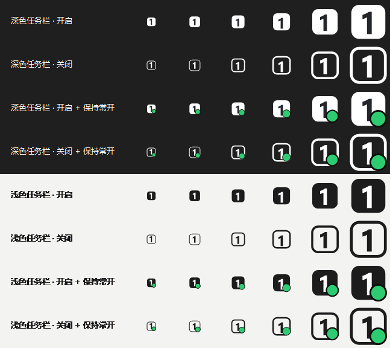
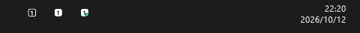
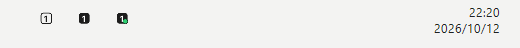
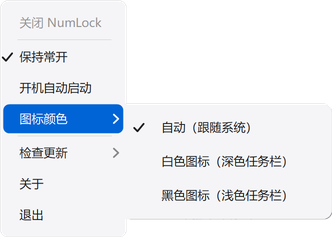
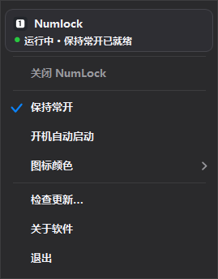
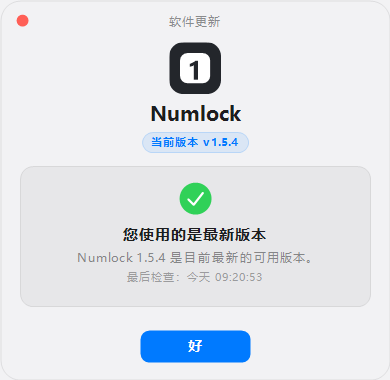
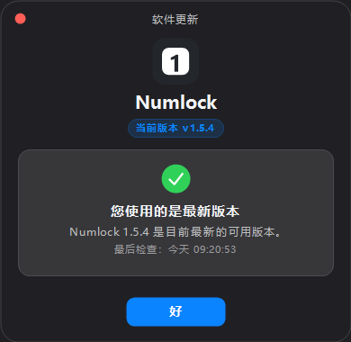

# Numlock

在系统托盘实时显示数字小键盘（NumLock）开关状态的小工具，支持将 NumLock **保持常开**。

C# / .NET 10 WinForms 编写，单文件绿色免安装，无需安装 .NET 运行时。



## 功能

- **托盘状态显示**：键帽图标实时反映 NumLock 状态——实心键帽 = 开启，描边键帽 = 关闭，右下角绿点 = 保持常开模式。
- **保持常开**（核心功能）：开启后
  - 拦截键盘上的 NumLock 键，按了也不会关闭；
  - 每 300ms 看护一次状态，被其他程序关掉也会自动恢复为开启；
  - 程序启动时若 NumLock 处于关闭状态，立即自动恢复。
- **双击托盘图标**：快速切换 NumLock（保持常开模式下会提示先关闭该选项）。
- **开机自动启动**：写入 `HKCU\...\CurrentVersion\Run`，无需管理员权限。
- **图标颜色**：自动跟随系统主题，也可手动指定白色/黑色图标。
- **macOS 风格菜单**：右键菜单为圆角面板，圆角蓝色高亮、自绘勾选/分隔线/子菜单箭头，配色随系统明暗。
- **高 DPI 适配**：菜单几何随所在显示器的缩放实时调整（Per-Monitor V2）；托盘图标在缩放变化后自动重绘。100%–400%（4K / 8K 显示器）下观感一致。
- **单实例运行**：重复启动只会提示“已在运行”。
- **自动更新**：启动后会检查新版本（可在菜单里关闭），发现新版本自动下载并校验；下载完成后在退出时静默替换，下次启动即新版本。若上次是关机/注销结束（来不及替换），**下次打开程序会自动完成替换并重启一次**（无需任何操作）；也可在菜单里选“重启并更新”立即生效。更新完成后会有**一次**“已更新到 X”的提示。
- **配置持久化**：`%AppData%\Numlock\config.json`。

## 联网说明

除“检查更新/下载更新”外，程序不进行任何网络通信（不联网、无遥测、不采集任何数据）。更新检查默认在启动后自动进行一次，也可在菜单里点击“检查更新…”随时检查。

## 截图

（截图由程序自带的自检模式渲染生成。）

深色任务栏（白色图标）：



浅色任务栏（黑色图标）：



右键菜单（浅色 / 深色）：





软件更新窗口（macOS 26 风格独立卡片）：





应用图标：


## 使用方法

1. 从 [Releases](../../releases) 下载 `Numlock.zip` 并解压（解压出 `Numlock` 文件夹；自包含版，无需安装 .NET）。
2. 双击 `Numlock\Numlock.exe` 运行（SmartScreen 提示时选择“仍要运行”）。
3. 托盘出现键帽图标后即可使用；双击图标切换，右键图标打开菜单。

发布页附有 zip 的 SHA-256，可用 `certutil -hashfile Numlock.zip SHA256` 核对下载完整性。

## 从源码构建

需要 .NET SDK 10.0+：

```bash
dotnet build Numlock.csproj -c Release
```

发布免安装的单文件版：

```bash
dotnet publish Numlock.csproj -c Release -r win-x64 --self-contained true -p:PublishSingleFile=true -p:EnableCompressionInSingleFile=true -p:IncludeNativeLibrariesForSelfExtract=true -p:DebugType=None -p:DebugSymbols=false -o publish
```

或直接运行 `publish.cmd`（自动发布 + 打包免安装 zip `Numlock.zip`，内含 `Numlock\` 文件夹）。

## 命令行参数（开发用）

- `--selftest <目录>`：无头自检（需先退出正在运行的托盘实例）。渲染图标/菜单/预览 PNG 并做像素检查，实测 SendInput 切换与“保持常开”看护，并断言按键拦截判定与配置解析容错。
- `--genico <路径>`：生成多尺寸应用图标 `assets/Numlock.ico`。
- `--check-update`：命令行检查更新（退出码 0=已最新、1=有新版本、2=检查失败；无控制台时以退出码为准）。
- `--apply-update <目标exe> <旧进程ID> [--restart]`：更新辅助模式（由程序自身在退出时调用，一般不手动使用）。

## 配置文件

设置保存在 `%AppData%\Numlock\config.json`：

```json
{
  "EnforceNumLock": false,
  "IconColorMode": "auto"
}
```

- `EnforceNumLock`：`true` = 保持常开；`false` = 关闭（默认）。
- `IconColorMode`：`auto`（跟随系统）/ `white`（白色图标）/ `black`（黑色图标）；非法值自动按 `auto` 处理。
- `CheckUpdatesOnStart`：`true` = 启动后自动检查更新（默认）；`false` = 只在菜单里手动检查。
- `UpdateNotifiedVersion`：最近一次已提示过的更新版本（同一版本只提示一次；一般无需手动修改）。

文件损坏或无法解析时会自动恢复默认值，并把原文件备份为 `config.json.bad`。

程序遇到内部错误时会在同目录另写 `error.log`（仅排障用，可随时删除；超过 256KB 会自动重写）。

## 系统要求

- Windows 10 / 11（x64）。
- 高 DPI 友好：100%–400% 缩放（含 4K / 8K 显示器与混合缩放多屏）。
- 自包含发布版无需任何运行时；源码构建需要 .NET SDK 10.0+。

## 已知限制

- “保持常开”在极端情况下（被高权限窗口拦截、系统回收钩子等）会降级为约 300ms 的自动纠偏（按键可能闪断），程序会气泡提示，功能不中断。
- 未做代码签名：首次运行时 SmartScreen 提示属正常现象（选择“仍要运行”）。
- 个别安全软件可能对键盘钩子机制给出提示，属其启发式判断。
- 自动更新需要能写入程序所在目录；放在只读位置（如某些 U 盘/受保护目录）时，程序会提示改为手动下载。

## 许可

[GPL-3.0](LICENSE)
